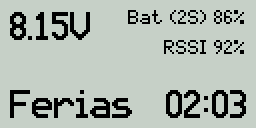
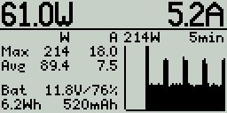

# EdgeTX Telemetry Screen

Telemetry screens for EdgeTX.

## Target hardware

Works with Radiomaster Pocket or with any other 128*64 monochrome LCD model.

## Screenshots

The script has a special flight mode feature for WLtoys XK A300 Beech D17S (with model name set to "Beech") but can be used with any aircraft.

### Generic

### WLtoys XK A300 Beech D17S

## Power monitor

`power.lua` shows current, power and battery usage with a current sensor such as the Radiomaster ERS-CU01.

